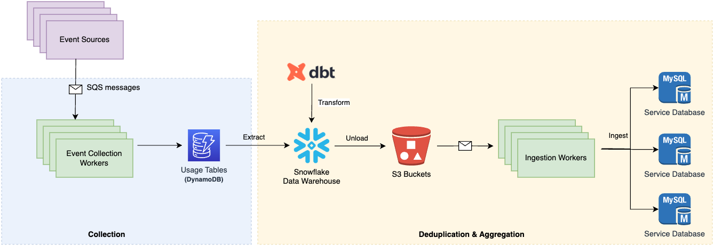

# Scalability

1. OLAP (Online Analytical Processing) databases: provide scalable storage and computing.
2. ELT (Extract, Load, Transform) pipeline leveraging OLAP databases to perform end-to-end calculations.

The new pipeline architecture can now aggregate billions of usage events in only a few minutes and easily scale to handle the usage growth. Also let us simplify our service codebase and the large amount of data we used to persist and maintain.

**Components:** 

1. Data Collection (usage events from web browsers, mobile apps, etc.) 
2. identify meaningful usage through deduplication (The service removes duplicated usage events and matches them with a set of specific classification rules. These rules define what we consider as distinct usages and how we should pay them)
3. Aggregation. The service calculates total number of deduplicated usages based on different dimensions, such as per design template or per brand.

Problems with MySQL: processing scalability due to increase database round trips, incident handling, overcounting, undercounting, misclassification, processing delay, storage consumption since MySQL RDS does not scale horizontally.

We used an OLAP database, for its advantage of being good at large complex data analysis and reporting. We chose Snowflake for most of the regions because it was already used as our primary data warehousing solution and we had reliable infrastructure support for it. 

**Extract and Load: We extracted our usage data from service databases and loaded it into the warehouse, using a data replication pipeline provided by our data platform.**

**Transform:** We then defined the calculation in each stage in scheduled data transformation jobs (using **DBT**). We wrote each transformation as an SQL query, selecting data from its previous stage and outputting it to the next. Intermediate transformation outputs were materialized as SQL Views that are simple and flexible to change. The following are the major steps:

- Extract from json data into structured SQL tables. We projected some of the json properties into separate table columns for optimization.
- Deduplicate and aggregate usage events. We defined deduplication rules to filter out duplicated usage events, and summed up total usage counts using GROUP BY queries.

*Data processing workflow with OLAP.*

an OLAP database like Snowflake separates storage and compute, such that we can scale its compute instances independently. In our case we can perform a complete **aggregation of billions of usage records within a few minutes** because most of the computation is now done in memory, which is several orders of magnitude faster than **database round trips**. We also reduced the entire pipeline latency **from over a day to under 1 hour**.

*Aggregation transformation using an outer join to fix broken usage counts.*

The aggregation query aggregates the output from the previous deduplication step, and compares it against the prior aggregated results through an outer join, such that the old results can be overwritten if they are found to be different. 

**Challenges:**

1. Transformation. The data transformation job uses an SQL-like language that we deploy as a standalone service separate from our main services. This makes the architecture less flexible. Maintaining a separate CI/CD pipeline for the DBT codebase also has extra costs.
2. We need a reliable pipeline that can unload data from Snowflake into databases used for other services because OLAP databases are not good at serving large volumes of requests with low latency within milliseconds. Therefore we built a scheduled worker that queries Snowflake periodically and choses S3 as an intermediary storage, integrated with SQS for its durability so that export data doesn’t get lost. The hard part was optimizing the ingestion query and carefully tuning the rate limit to control the throughput, such that it could ingest data with reasonable speed, without causing our service databases to throttle. 
3. Infrastructure complexity: it also increased infrastructure complexity resulting from the data replication integration and the standalone services running transformation jobs. For example, we need to put in extra effort to obtain observability of these parts because of the different toolings used.

# <u>**How Canva collects 25 billion events per day:**</u>

The **Protobuf** language to define contracts between microservices, we decided to re-use the same language to define the analytics event schema, with one extra special rule: event schema must have full transitive compatibility. That is, schemas must be forward- and backward-compatible, meaning we can use any schema version to deserialize any version of an event. We store analytics events indefinitely, so systems must be able to read: Old data using newer schema and vice verse

A Protobuf schema is used for service-to-service APIs, and we only have to maintain compatibility until we’re sure all consumers and producers have updated to the newest version. Meanwhile, our event schemas are a type of persistence schema, defining the shape of the data stored at rest (for example, in our Data Warehouse). To support a breaking change in a schema, we’d need to perform a data migration of all historical event data into the new schema which is time-consuming and costly.

To automatically enforce the rules, we built our own code generator on top of `protoc`, which we call Datumgen. We define and store all our event schemas in our repository alongside product code. When someone creates or updates an event schema, Datumgen is triggered to verify that the schema version follows compatibility rules and generates code in multiple languages to assist with sending and consuming events. Datumgen generates:

- **Typescript definitions**: Used by the Canva frontend to enable compile-time type checks for every event fired.
- **Java definitions**: Used to send events from the backend servers and for consuming events in Java processes.
- **SQL definitions**: Used to define table schemas in Snowflake.
- **Event Catalog**: Used to render a searchable event catalog UI, where anyone in Canva can explore the events we collect, the fields they contain, and where they’re delivered. With over 2000 unique event types (and more added weekly as the Canva feature set continues to expand), this is an important tool to assist in data discovery and minimize duplicate work between teams.

Every event must have:

- Two owners to make sure every event in our catalog is up-to-date and has a clear purpose:
    - **Technical owner**: Responsible for the code that fires the event. For new events, the technical owner is usually the pull request (PR) author. This would typically be a frontend or backend engineer.
    - **Business owner**: Knows about the context and structure of the event. Business owners are typically Data Scientists.
- Comments explaining its purpose and the meaning of its fields. Comments serve as documentation in the event catalog and the Snowflake table schemas.

**Collect:**

High-level architecture of the analytics-event service

- We maintain a set of analytics clients for the various platforms that Canva can run on. To reduce the surface area that our team has to cover and minimize maintenance effort, all front-end analytics clients share the same core library underneath, written using TypeScript and running inside a [**WebView environment**](https://en.wikipedia.org/wiki/WebView). We only need to communicate with the native application to retrieve information about the device. This way, our team maintains only a single client codebase, plus some very simple APIs for retrieving device details.
- We then collect all events through an endpoint in our server. The server validates that every event received conforms to a predefined schema before sending them to the ingest-worker asynchronously through a Kinesis Data Stream (KDS). Any events with invalid schemas are discarded.
- Inside the ingest-worker, we perform some transformations, enriching the events with more details such as country-level geolocation data, user device details, and [**correcting client-generated timestamps**](https://snowplow.io/blog/improving-snowplows-understanding-of-time/). Having a separate worker do this processing means we can do as much work as we need and depend on other services without compromising the response time of the collection endpoint in the server. When all the enrichment work is done, the events are forwarded to another KDS to make their way to the router.
    - After running the MVP version, one of our first goals was to migrate away from SQS and SNS. Because Canva was running entirely on AWS, we decided to stay with AWS offerings and explored 2 options: Amazon Managed Streaming for Apache Kafka (MSK) and Amazon Kinesis Data Stream (KDS).
    - KDS reduced cost by 85%, performance increased by 30% as compared to MSK, is low maintainence and requires less tuning.
    - Instead of sending each event as a separate record, we grouped them into batches of a few hundred events, applied [**zstd**](https://github.com/facebook/zstd) compression, and sent the compressed payload as a single record. Because analytics events usually have a lot of repeated data, we achieved a 10x compression ratio while only taking about 100ms per batch to compress and decompress the data.
    - Although the average latency of KDS is pretty good (around 7 ms), it does suffer from high tail latency (greater than 500 ms). Furthermore, each KDS shard has a hard limit of 1MB/s write throughput, so sometimes, a shard could be overloaded for a short period of time. The solution for both of these problems was to send events to an SQS whenever we were throttled by a KDS shard or whenever we spend too much time waiting for a KDS response. Essentially, we’re using SQS as an overflow protection for KDS. As a result, we kept our response time p99 consistently less than 20 ms
    - With a decoupled router, we have the flexibility to implement different router types based on consumer characteristics or priority level. When an event makes its way to the router, it’s ready to be distributed to consumers. We declare all consumers in configuration files in the repository and deploy them together with the router.
    - We deliver all event types into Snowflake using **Snowpipe Streaming**. This is what the majority of models, dashboards, and analyses use as their data source.
    - For other backend services wanting to consume the event stream in real time, such as for personalization and recommendation, we support 2 subscription types: KDS and SQS. For services wanting to consume only 2-3 event types, we usually recommend an SQS queue because of its ease of maintenance. For services wanting to consume 100s of events, we recommend KDS because of its cost-effectiveness.